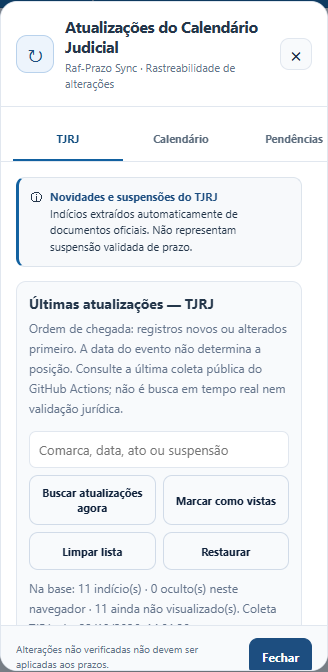
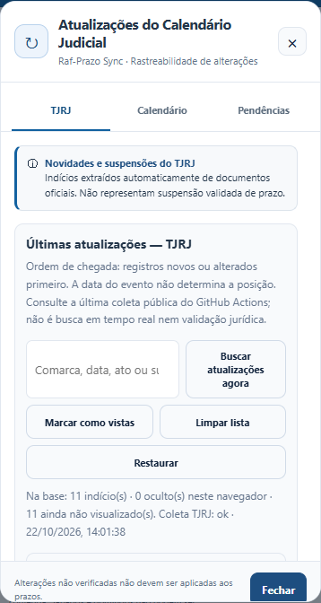
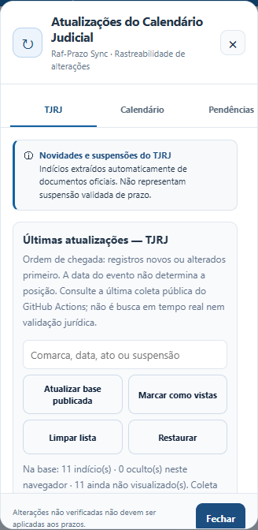
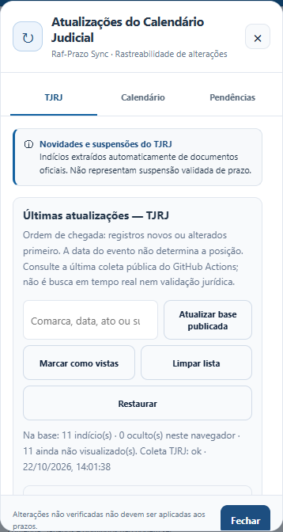

# Raf-Prazo — Continuidade e auditoria da Central de Atualizações\n\n**Data:** 22/10/2026\n**Repositório:** https://github.com/rafaelmsp/raf-prazo\n**Branch:** auditoria/central-atualizacoes-20261022\n**SHA inicial da main:** 85dcc68642aa848de56e8d674b5cbc429d9bf437\n**Commit funcional:** 6e47b16 — fix: limpar atualizacoes completas e preservar estados locais\n**Estado da publicação:** depende da integração da branch e da verificação do GitHub Pages.\n\n## 1. Entrega já existente e preservada\n\nA branch main possuía cinco abas — TJRJ (inicial), Calendário, Pendências, Fontes e Sincronização — além de base estática, pesquisa do TJRJ, detalhes expansíveis, controles de ocultação/restauração, regras conservadoras de prazo, simulações locais de exclusão de datas e os módulos Raf-Prazo 2.2/Balcão Virtual. Não houve reimplementação do motor jurídico.\n\nNenhuma correção deste ciclo exigiu alteração em calculate(), reason(), baseEvent(), feriados.json, dados/coleta-tjrj.json ou nas regras de termo inicial, fins de semana, JEC e CPC.\n\n## 2. Defeitos reproduzidos antes de editar\n\n| Regressão em Chrome | Antes | Depois |\n| --- | --- | --- |\n| Limpar 65 alterações de calendário | 40 ocultadas; 25 ainda visíveis | 0 visíveis |\n| Limpar 130 pendências | 60 ocultadas; a página ainda exibia 60 | 0 visíveis |\n| Limpar 55 notícias filtradas por comarca mencionada | 40 visíveis permaneciam | 0 visíveis |\n| Reabrir a Central diretamente em TJRJ | Sino caía de 80 para 55 sem visualizar Calendário | Contador permanece 65 até abrir Calendário |\n| Chegar nova versão de notícia ocultada | Necessitava teste específico | Versão com novo hash reaparece |\n| Falha ao gravar preferências | Necessitava teste específico | Alerta real; cartão permanece |\n\nA última linha do TJRJ decorre do filtro: o texto pesquisável incluía comarcas mencionadas, mas a ação de limpar comparava somente parte dos campos. A correção adotou um único predicado para ambos.\n\n## 3. Mudanças realizadas\n\n- Limpar lista oculta todos os resultados elegíveis da aba/filtro selecionado, inclusive registros que não foram renderizados pelos limites de 40 e 60 cards. A confirmação informa a quantidade e o escopo exatos.\n- Restauração continua reversível e exclusiva da aba. A gravação é feita somente em localStorage; se falhar, aparece aviso e a interface não anuncia sucesso.\n- Retirados cortes silenciosos de IDs ocultos no Calendário, Pendências e feed TJRJ. Eventos novos ou versões alteradas podem reaparecer.\n- A abertura da Central não marca silenciosamente as mudanças do Calendário como vistas; isso só ocorre ao selecionar sua própria aba.\n- A pesquisa TJRJ mantém a ordem por chegada/alteração, e o botão informa que atualiza somente a base já publicada, não o portal do tribunal em tempo real.\n- A lista explicita quando há mais de 40 resultados, apresenta status técnicos importantes também em português, preserva os cinco painéis e mantém botões mais acessíveis ao toque.\n- Melhor visibilidade da aba selecionada na navegação horizontal mobile.\n\n## 4. Testes e evidências\n\n**Referência antes da mudança:** 42 testes Node selecionados aprovados e 67 Python aprovados. Os novos cenários funcionais reproduziram quatro falhas de comportamento.\n\n**Após correção:**\n- 79 testes Node aprovados, 0 falhas.\n- 67 testes Python aprovados, 0 falhas.\n- Chrome/Playwright: 320, 360, 390, 412, 430 e 1366 px, com cinco abas, teclado, filtro, fechar/abrir, limpar, cancelar, restaurar, reload, tema e isolamento.\n- Teste específico test_updates_bulk_browser.py: oito cenários aprovados, incluindo acima de 40 registros, atualização documental, indisponibilidade do armazenamento e preservação de decisões de prazo.\n- Validação de sintaxe dos scripts JS, JSON público e geração reprodutível de index.html pelo build_html.py.\n\n### Capturas da janela em Chrome\n\n| 360 px | 390 px |\n| --- | --- |\n|  |  |\n|  |  |\n\n**Importante:** capturas e testes em Chrome emulado são evidência funcional de navegador; não constituem teste presencial em um aparelho Android físico.\n\n## 5. Isolamento da contagem e segurança jurídica\n\nAs chaves de ocultação dos três conjuntos de notícias/alterações/candidatos são isoladas entre si. Ocultar/limpar/restaurar não modifica as chaves raf-prazo:tjrj-exclusions-user:v1 nem raf-prazo:exclusoes-individuais:v1. O cenário automatizado insere valores sentinela nessas duas chaves e confirma que permanecem idênticos após as limpezas.\n\nIndícios TJRJ com pending_review, verified=false ou applies_to_deadlines=false não são promovidos a suspensões oficiais e não alteram automaticamente o vencimento. Indisponibilidade, expediente e ponto facultativo não comprovam, por si, suspensão de prazo.\n\n## 6. Fontes, cobertura e limites\n\nA coleta de fontes oficiais é agendada pelo GitHub Actions, sujeita a falhas ou indisponibilidade. O botão do navegador recarrega a base pública feriados.json; não faz pesquisa direta no portal TJRJ. Horário da coleta não equivale à data do ato processual. Notícias sem validação exigem conferência do documento, abrangência, comarca, atos correlatos e efeitos jurídicos.\n\nA presente auditoria não comprova cobertura integral do TJRJ, nem substitui análise jurídica de prazo. O Raf-Prazo permanece gratuito, estático e sem login/perfis.\n\n## 7. GitHub Actions e publicação\n\nO primeiro commit deste ciclo contém alterações funcionais, testes de regressão e quatro capturas. A conclusão a 100% exige verificar o pipeline no GitHub, integrar a branch na main sem perder mudanças concorrentes, conferir GitHub Pages após o deploy e executar verificação do conteúdo público. O código local não equivale à versão publicada.\n\n**Status verificável no momento desta redação: 75% — implementação e testes locais aprovados; publicação ainda não certificada.**\n